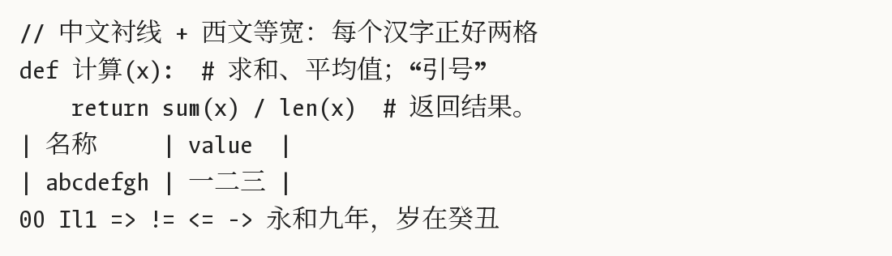

# Bright Serif Code

中文宋体 + 西文等宽的编程字体。一个汉字正好占两个西文字符宽，中英文混排的注释和表格能对齐。



- **西文、符号、编程连字**：来自 [LXGW Bright Code](https://github.com/lxgw/LxgwBright-Code)（西文基于 [Monaspace Argon](https://github.com/githubnext/monaspace)）
- **汉字、假名、全角标点**：来自 [Noto Serif SC](https://github.com/notofonts/noto-cjk)（与思源宋体字形相同）
- **字重**：ExtraLight、Light、Regular，各带 Italic（斜体只作用于西文，汉字保持正体）

## 下载与安装

到 [Releases](https://github.com/LosLiSang/bright-serif-code/releases) 下载 `.ttf`，双击安装即可。

VS Code：

```json
"editor.fontFamily": "'Bright Serif Code'",
"editor.fontLigatures": true
```

宋体横画较细，建议字号 14px 以上或在高分屏上使用。

## 自行构建

需要 [uv](https://docs.astral.sh/uv/) 和带 7z 支持的 `tar`（Windows 10+ 和 macOS 自带；Linux 安装 `libarchive-tools`）。

```sh
uv run build.py
```

脚本会下载固定版本的上游字体到 `build/`，合成结果输出到 `dist/`。上游版本号在 `build.py` 顶部。

## 许可证

[SIL Open Font License 1.1](OFL.txt)。

本字体是 LXGW Bright Code 与 Noto Serif SC 的修改版本。依照 OFL 的保留字体名条款，字体已更名，名称中不包含 “LXGW”、“霞鹜”、“Monaspace”、“Source” 等保留名称。本项目与上游作者无关。
